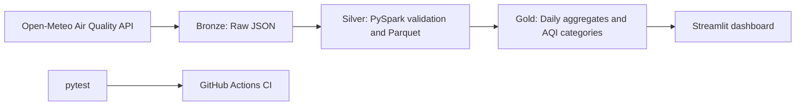

# Jamshedpur AirWatch 🌫️

A reproducible **data engineering and analytics project** that explores hourly and daily air-quality trends for Jamshedpur, Jharkhand.

The project turns public air-quality data into a Bronze → Silver → Gold pipeline using Python and PySpark, then presents the resulting analytics in an interactive Streamlit dashboard.

> **Important data limitation:** Open-Meteo provides model-based, grid-level estimates. These are not confirmed readings from a physical monitoring station. Outdoor AQI alone also cannot determine whether a person needs an air purifier.

## Dashboard

The Streamlit dashboard includes:
- KPI cards for average and maximum US AQI, average PM2.5, and unhealthy hours.
- Date-range filtering.
- Daily average and maximum AQI trends.
- Average pollutant concentration comparisons.
- Daily AQI category distribution.
- A daily analytics table with CSV download.

## Architecture



### Data layers

| Layer | Purpose | Output |
|---|---|---|
| Bronze | Preserve the API response and retrieval metadata | `data/raw/*.json` |
| Silver | Flatten hourly arrays, parse timestamps, validate records and remove duplicate timestamps | `data/silver/air_quality_hourly/` |
| Gold | Aggregate hourly records by date, calculate pollutant averages, AQI ranges and unhealthy hours | `data/gold/daily_air_quality/` |

Generated JSON and Parquet data are excluded from Git. Run the pipeline locally to create the datasets before launching the dashboard.

## Technology

- Python 3.11+
- PySpark 3.5
- Apache Spark SQL
- pandas
- Streamlit
- Plotly
- Open-Meteo Air Quality API
- pytest and GitHub Actions

## Run locally

### 1. Prerequisites

Install Git, Python 3.11 or later, and Java 17. The pipeline has been developed and tested in Ubuntu 24.04 on WSL.

### 2. Clone and set up

```bash
git clone https://github.com/rajdeep-senapati/jamshedpur-airwatch.git
cd jamshedpur-airwatch

python3 -m venv .venv
source .venv/bin/activate

python -m pip install --upgrade pip
pip install -r requirements.txt
```

Configure PySpark to use the active Python environment:

```bash
export PYSPARK_PYTHON="$(which python)"
export PYSPARK_DRIVER_PYTHON="$(which python)"
```

### 3. Run the pipeline

**Bronze — ingest raw hourly data**

```bash
python scripts/ingest_open_meteo.py --past-days 7
```

The API endpoint used by this project does not require an API key. The initial ingestion script supports a window of 1–7 past days.

**Silver — validate and transform**

```bash
python scripts/transform_silver.py
```

The script selects the latest raw extract, validates hourly arrays and timestamps, checks duplicate timestamps and null AQI/pollutant values, and writes date-partitioned Parquet data.

**Gold — build daily analytics**

```bash
python scripts/build_gold.py
```

This creates daily averages, minimum and maximum US AQI, pollutant averages, unhealthy-hour counts, and AQI categories.

### 4. Launch the dashboard

Run from the repository root after generating the Gold dataset:

```bash
python -m streamlit run dashboard/app.py
```

Open the local URL printed by Streamlit (normally http://localhost:8501).

### 5. Run tests

```bash
PYTHONPATH=. pytest -q
```

The tests cover project structure, AQI category boundaries, and Gold transformation behavior. GitHub Actions runs the test suite on pushes and pull requests.

## Data source and interpretation

- **Provider:** [Open-Meteo Air Quality API](https://open-meteo.com/en/docs/air-quality-api)
- **Location:** Jamshedpur, Jharkhand, India
- **Requested coordinates:** 22.8046° N, 86.2029° E
- **Timezone:** Asia/Kolkata
- **Hourly variables:** PM2.5, PM10, US AQI, European AQI, nitrogen dioxide, ozone, sulphur dioxide, and carbon monoxide.

The returned coordinates may represent the nearest model grid cell rather than the exact requested point. Concentrations are shown in the source-reported units. US AQI categories use the standard US AQI bands; European AQI values are a separate scale and should not be compared numerically with US AQI.

## Repository structure

```text
.
├── .github/workflows/ci.yml
├── dashboard/
│   ├── app.py
│   ├── charts.py
│   └── data_loader.py
├── data/
│   ├── raw/       # generated JSON; not committed
│   ├── silver/    # generated hourly Parquet; not committed
│   └── gold/      # generated daily Parquet; not committed
├── notebooks/
├── scripts/
│   ├── ingest_open_meteo.py
│   ├── transform_silver.py
│   └── build_gold.py
├── src/airwatch/
├── tests/
├── requirements.txt
└── README.md
```

## Scope and next improvements

The current implementation is a reproducible batch pipeline with a dashboard over the generated Gold dataset. Potential next steps include scheduled ingestion, longer historical coverage where available, incremental processing, and deployment with a managed data artifact.

## License

This project is licensed under the MIT License. See [LICENSE](LICENSE).
